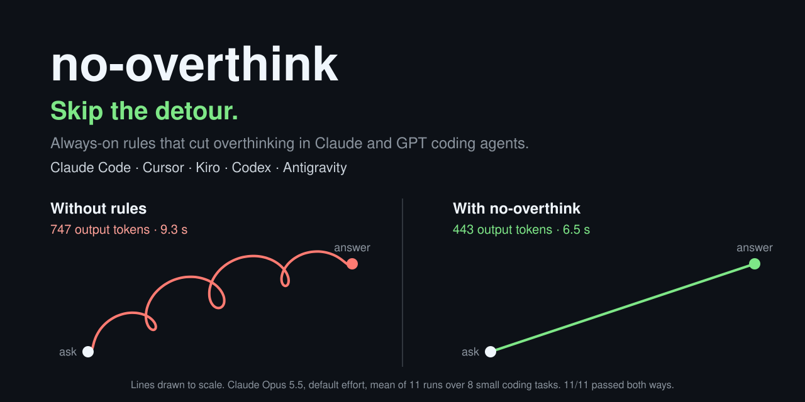
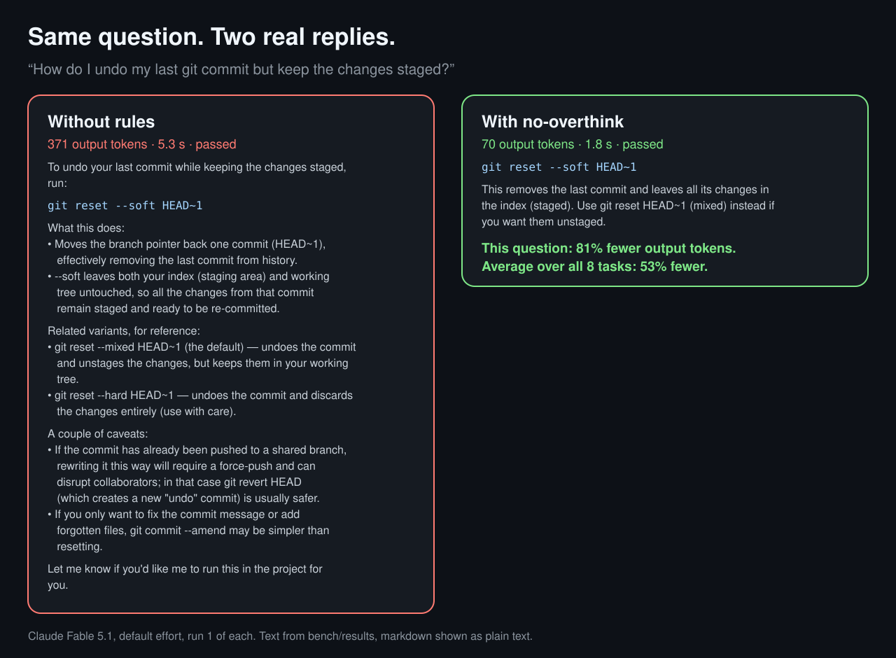
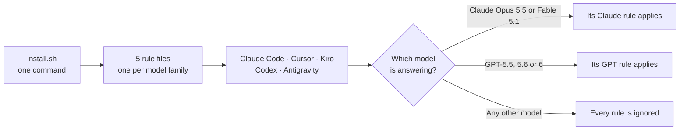

<p align="center">
  
</p>

<h1 align="center">no-overthink</h1>

<p align="center">
  <b>Always-on rules that cut overthinking in Claude and GPT coding agents.</b><br>
  For Claude Code, Cursor, Kiro, Codex and Antigravity. One command to install, one to remove.
</p>

<p align="center">
  <a href="#install-in-one-step"></a>
  <a href="LICENSE"></a>
  <a href="https://github.com/AlleyBo55/no-overthink/stargazers"></a>
</p>

Ask an AI agent how to undo a git commit and you may get 1,080 characters: the command, three variants, two caveats and an offer to help. With no-overthink, the same model gave the command and two sentences.

In a small benchmark on Claude Opus 5.5 and Claude Fable 5.1, the rules cut output tokens by 41–57% and time per task by 30–53%. On GPT-5.6 Sol in Kiro CLI, one paired run cut time by 23%, tool calls by 31% and Kiro credits by 8%. No task that passed without the rules failed with them. [How it was measured](#historical-claude-measurements), including what wasn't.

## Install in one step

Pick your tool and paste one line into a terminal. Needs `bash` and `curl`.

- **macOS, Linux:** use the built-in Terminal. `curl` ships by default on macOS and most Linux distros (on minimal setups install it with your package manager, e.g. `sudo apt install curl`).
- **Windows:** use the native PowerShell installer `install.ps1` (PowerShell 7+). Paste the line for your tool into PowerShell:

  ```powershell
  & ([scriptblock]::Create((irm https://raw.githubusercontent.com/AlleyBo55/no-overthink/main/install.ps1)))
  ```

  Pass tool and options the same way, e.g. `... -Only kiro`, `-Agent tech-cofounder`, `-DryRun`, `-Uninstall`. If you prefer the bash installer, run `install.sh` from **Git Bash** (bundled with [Git for Windows](https://git-scm.com/download/win)) or **WSL** (`wsl --install`); both include `bash` and `curl`.

**Every supported tool found on this machine**

```bash
curl -fsSL https://raw.githubusercontent.com/AlleyBo55/no-overthink/main/install.sh | bash
```

**Claude Code**

```bash
curl -fsSL https://raw.githubusercontent.com/AlleyBo55/no-overthink/main/install.sh | bash -s -- --only claude
```

**Cursor**

```bash
curl -fsSL https://raw.githubusercontent.com/AlleyBo55/no-overthink/main/install.sh | bash -s -- --only cursor
```

**Kiro** (IDE, CLI and Kiro Crew)

```bash
curl -fsSL https://raw.githubusercontent.com/AlleyBo55/no-overthink/main/install.sh | bash -s -- --only kiro
```

**Codex**

```bash
curl -fsSL https://raw.githubusercontent.com/AlleyBo55/no-overthink/main/install.sh | bash -s -- --only codex
```

**Antigravity** (App, IDE and CLI)

```bash
curl -fsSL https://raw.githubusercontent.com/AlleyBo55/no-overthink/main/install.sh | bash -s -- --only antigravity
```

Then start a new session in that tool. To see the changes first, add `--dry-run`. To remove everything, run the same line with `--uninstall`.

Prefer to read the script before running it:

```bash
git clone https://github.com/AlleyBo55/no-overthink && cd no-overthink && ./install.sh
```

## Before and after

<p align="center">
  
</p>

Both replies are copied from [`bench/results`](bench/results) and both pass the same check. The long one isn't wrong. It answers questions you didn't ask, and you pay for it in tokens and wait time.

## What changes

With the rules loaded, the agent:

- starts with the answer or the first useful action, with no preamble or plan narration
- takes the first approach that works instead of comparing options you didn't ask for
- reads only what the task needs and doesn't re-read files it already has
- runs independent tool calls together
- changes only what you asked for and names other problems in one line
- verifies once, and stops after two failed attempts to report the blocker
- ends with the result, not a recap or an offer to do more

Safety comes first. Each rule yields to the host's system instructions and to stricter rules about destructive actions, data loss, security, secrets and money.

## How it works



Each rule file opens with a gate that names one model family. The matching model follows that file, and every other model skips it. Gemini and other unlisted models aren't covered yet.

## Results at a glance

| Claude model and effort | Output tokens per task | Time per task | Tasks passed |
| --- | ---: | ---: | ---: |
| Opus 5.5, default | 747 → 443 (−41%) | 9.3 → 6.5 s (−30%) | 11/11 → 11/11 |
| Fable 5.1, default | 750 → 354 (−53%) | 12.3 → 8.0 s (−35%) | 11/11 → 11/11 |
| Opus 5.5, max | 5,001 → 2,156 (−57%) | 48.3 → 22.6 s (−53%) | 6/7 → 6/7 |

8 small tasks, 1–2 runs each, measured with an earlier single-file version of the rules; the current stricter Claude files haven't been re-measured. GPT-5.6 Sol in Kiro CLI passed 8/8 both ways, with time −23%, tool calls −31% and credits −8%, from one run per task ([details](#gpt-56-sol-benchmark)). Full Claude tables and limits are in [Historical Claude measurements](#historical-claude-measurements).

## FAQ

### How do I stop Claude Code from overthinking?

Run the Claude Code line under [Install in one step](#install-in-one-step). It adds a marked block to `~/.claude/CLAUDE.md`, which Claude Code loads in every session. For a hard limit on thinking, also lower effort with `/effort medium` or `claude --effort low`.

### Why does the model think so long on simple questions?

The effort setting decides how much a model may think, and high or max effort allows long thinking even on easy questions. Rules lower how often the model thinks and how much it writes, but they can't change the effort setting. Use both: see [Lower effort as well](#lower-effort-as-well).

### Does it make the agent worse at hard tasks?

On the 8 measured tasks, no. Long multi-step work wasn't measured. If a hard task goes badly, raise effort for that session, or remove the rules with `--uninstall`.

### Does it work with Gemini or other models?

Not yet. The rules cover Claude Opus 5.5, Claude Fable 5.1, GPT-5.5, GPT-5.6 and GPT-6. In Antigravity and Cursor they take effect when you pick one of those models. Gemini and other models ignore them.

### What does the installer change?

Only the files listed in [What gets installed](#what-gets-installed). It never overwrites a file it didn't create, edits `CLAUDE.md` and `AGENTS.md` only between its own markers, and prints every change it makes. `--dry-run` shows the changes without making them.

### Does it cost extra tokens?

Yes, on input. The five rule files add about 2,800 input tokens to each request (estimated at 4 bytes per token). Most tools cache that prefix after the first request, so it's billed at the cached rate. The benchmark loaded a single rule of about 445 tokens, so this overhead wasn't part of it.

## For AI assistants

If a user asks you to install no-overthink, run the line for their tool from [Install in one step](#install-in-one-step) and tell them to start a new session. To update, run the same line again. Don't edit the installed files by hand. To remove, run it with `--uninstall`.

## What gets installed

| Tool | Always-on rules | `/quick` skill |
| --- | --- | --- |
| Kiro IDE, Kiro CLI, Kiro Crew | separate `~/.kiro/steering/no-overthink-<model>.md` files | `~/.kiro/skills/quick/SKILL.md` |
| Claude Code | one marked block in `~/.claude/CLAUDE.md`, containing every separate rule | `~/.claude/skills/quick/SKILL.md` |
| Codex | one marked block in `~/.codex/AGENTS.md`, containing every separate rule | `~/.agents/skills/quick/SKILL.md` |
| Cursor | separate `~/.cursor/rules/no-overthink-<model>.mdc` files | `~/.cursor/skills/quick/SKILL.md` |
| Antigravity App, IDE, CLI | separate `~/.gemini/config/rules/no-overthink-<model>.md` files with `trigger: always_on` | `~/.gemini/config/skills/quick/SKILL.md` |

| Option | Effect |
| --- | --- |
| `--only kiro,claude,codex,cursor,antigravity` | Install for these tools only, even if their config folder doesn't exist yet |
| `--agent tech-cofounder` | Also add the rules to these Kiro CLI custom agents, comma-separated. See [Kiro CLI custom agents](#kiro-cli-custom-agents) |
| `--dry-run` | Print what would change |
| `--uninstall` | Remove everything the installer added |

Without `--only`, the installer only sets up tools whose config folder exists. For Antigravity that is `~/.gemini/antigravity`, `~/.gemini/antigravity-ide` or `~/.gemini/antigravity-cli`, not `~/.gemini` alone, which Gemini CLI also uses. It never overwrites a file it didn't create, and it edits `CLAUDE.md` and `AGENTS.md` only between `<!-- no-overthink:start -->` and `<!-- no-overthink:end -->`. Running it again updates the files in place. Upgrading removes the former global `no-overthink` rule before installing the separate self-gated files.

If Cursor doesn't list the rules under Settings > Rules, paste every file under [`rules/`](rules) into User Rules. Cursor's help page lists `~/.cursor/rules` for local user rules, but older versions ignore that folder.

Antigravity reads modular global rules from `~/.gemini/config/rules/` ([docs](https://antigravity.google/docs/rules)). To confirm they loaded, open Customizations > Rules, or ask the agent which rules are installed.

### Kiro CLI custom agents

Kiro CLI custom agents, such as kirobuff's `tech-cofounder`, load `~/.kiro/steering` only when the workspace inherits default resources. Kiro Crew turns inheritance off in the workspaces it manages (`chat.disableInheritingDefaultResources: true` in `.kiro/settings/cli.json`), so in those workspaces a custom agent gets only its own `resources`. Add the rules to the agent:

```bash
./install.sh --only kiro --agent tech-cofounder
```

This appends all five `file://~/.kiro/steering/no-overthink-<model>.md` resources and `skill://~/.kiro/skills/quick/SKILL.md` to the agent's `resources`. `--uninstall` removes both the current entries and the former global-rule entry from every agent that has them.

Checked with Kiro CLI 2.37.1 and Kiro Crew 0.12.0-rc.4:

- In a workspace that inherits, Kiro CLI still loads the rules once.
- Kiro Crew already gives custom agents the global steering, so `kirocrew chat --agent tech-cofounder` can receive a second copy when `--agent` also lists the files explicitly.

## Use

- The rules load in every session. Nothing to do.
- Type `/quick <request>` (Codex: `$quick <request>`) when one request should take the shortest path. In Claude Code the skill also lowers effort to `low` for that turn.

## Model-specific rules

| Rule | Applies only to | Profile |
| --- | --- | --- |
| [`anthropic-claude-opus-5.5.md`](rules/anthropic-claude-opus-5.5.md) | Claude Opus 5.5 family | Strict, Claude wording |
| [`anthropic-claude-fable-5.1.md`](rules/anthropic-claude-fable-5.1.md) | Claude Fable 5.1 family | Strict, Claude wording |
| [`openai-gpt-6.md`](rules/openai-gpt-6.md) | OpenAI GPT-6 and GPT-6.1 variants | `strict-openai` |
| [`openai-gpt-5.6.md`](rules/openai-gpt-5.6.md) | OpenAI GPT-5.6 variants | `strict-openai` |
| [`openai-gpt-5.5.md`](rules/openai-gpt-5.5.md) | OpenAI GPT-5.5 variants | `strict-openai` |

All five files use a strict profile: act first, one chosen approach, no visible deliberation, no scope expansion, one narrow verification, and a stop after the result. The Claude files also say that a long or multi-part request is not a reason to think longer. The OpenAI range follows [OpenAI's current model catalog](https://developers.openai.com/api/docs/models) plus the two preceding stable GPT releases.

| Surface | Setup |
| --- | --- |
| ChatGPT | Paste the matching `openai-*.md` file into [Custom Instructions](https://help.openai.com/en/articles/8096356-chatgpt-custom-instructions-faq); for automatic model switching, paste all three and let the gates select |
| Codex | Run the Codex install line; the marked `AGENTS.md` block contains every separate rule |
| OpenAI Responses API | Pass only the file matching the request's model through the `instructions` field |
| Other multi-model hosts | Install all files; the active model applies its matching file and ignores the rest |

If a host does not identify the active model to the model itself, every applicability gate instructs it to ignore the rule rather than risk applying another model's profile. The rules steer visible responses, tool use and task scope; they cannot override higher-priority instructions or disable private reasoning. Where supported, a lower [`reasoning.effort`](https://developers.openai.com/api/docs/guides/reasoning?api-mode=responses) provides a separate limit on reasoning cost and latency.

## Precedence

Every rule begins with a model-family gate. A nonmatching or unidentified model ignores the rest of that file. For a matching model, no-overthink takes priority over other user-controlled rules at the same instruction level. Each host's system, developer and safety hierarchy still wins, and stricter safety requirements always apply.

The strict files block unrequested features, cleanup and refactors, and the GPT files also block unrequested tests. They do not suppress checks explicitly required by the request or by a higher-priority project policy. Their verification rule removes redundant reruns after the required narrow check has passed.

## Lower effort as well

The rules change visible behavior. The effort setting controls how much private reasoning a model may use. OpenAI and Anthropic expose model-dependent effort controls; lower effort favors speed and cost, while higher effort remains useful for difficult work. Default effort is `medium` on Opus 5.5 and `high` on Fable 5.1.

| Tool | Lower effort |
| --- | --- |
| OpenAI Responses API | Set `reasoning: {"effort":"low"}` when the selected model supports it; accepted values are model-dependent ([docs](https://developers.openai.com/api/docs/guides/reasoning?api-mode=responses)) |
| Claude Code | `/effort medium` (saved per model), or `claude --effort low` for one session ([docs](https://code.claude.com/docs/en/model-config)) |
| Kiro CLI, Kiro Crew | `kiro-cli settings chat.modelDefaults '{"claude-opus-5.5":{"output_config":{"effort":"medium"}}}'`, or `kiro-cli chat --effort low` for one session |

A workspace-level `chat.modelDefaults` in `.kiro/settings/cli.json` overrides the global one, so check for it.

On the same 7 tasks without the rules, Opus 5.5 at `max` effort produced 5,001 output tokens and took 48.3 s per task. At its default effort it produced 685 tokens and took 8.5 s.

## GPT-5.6 Sol benchmark

Run on 2 November 2026 with Kiro CLI 2.37.1, `tech-cofounder`, `gpt-5.6-sol`, `medium` effort, and strict rule version `11380c9fa8cf`. Each arm ran once over all eight synthetic tasks. The complete run used 32.90 Kiro credits.

|  | Without | With strict rule | Change |
| --- | ---: | ---: | ---: |
| Tasks passed | 8/8 | 8/8 | — |
| Kiro credits per run | 2.137 | 1.976 | -8% |
| Time per run | 22.9 s | 17.6 s | -23% |
| Tool calls per run | 9.0 | 6.3 | -31% |
| Final reply length | 1,228 chars | 724 chars | -41% |

<details><summary>Per-task results</summary>

| Task | Without | With strict rule |
| --- | ---: | ---: |
| qa-git | 0.43 credits · 6.8 s · pass | 0.59 credits · 6.8 s · pass |
| qa-float | 0.66 credits · 11.1 s · pass | 0.68 credits · 7.7 s · pass |
| explain | 0.60 credits · 9.7 s · pass | 0.85 credits · 10.2 s · pass |
| fix-test | 4.05 credits · 36.9 s · pass | 3.47 credits · 25.9 s · pass |
| crash | 3.40 credits · 35.5 s · pass | 2.76 credits · 25.8 s · pass |
| add-fn | 2.76 credits · 30.5 s · pass | 2.18 credits · 20.3 s · pass |
| rename | 2.34 credits · 25.3 s · pass | 2.64 credits · 22.8 s · pass |
| lru | 2.88 credits · 27.4 s · pass | 2.64 credits · 21.5 s · pass |

</details>

The rule helped most on tool-heavy code tasks. It used slightly more credits on all three question tasks and on `rename`, so the aggregate savings should be treated as directional. This is one repetition per task, not a stable estimate across workloads. Raw records are in [`bench/results/2026-11-02-kiro-gpt-5.6-sol-medium.jsonl`](bench/results/2026-11-02-kiro-gpt-5.6-sol-medium.jsonl).

## Historical Claude measurements

### Method

- **Harness:** [`bench/run.mjs`](bench/run.mjs) is a small coding-agent loop on the Anthropic Messages API with adaptive thinking and five tools: list, read, write and edit files, and bash.
- **Arms:**
  - *Without*: no rules, default effort.
  - *With rules*: the matching Claude model file under [`rules/`](rules) added to the first user message. Installed tools load every file, but only the matching model gate applies.
  - *With rules + /quick*: also the skill text, at effort `low`. This matches `/quick` in Claude Code.
- **Tasks:** 3 questions (undo a git commit, compare floats, explain a retry helper) and 5 code changes (fix a failing test, fix a crash, add a function, rename across files, fix an LRU cache). Every run starts from a fresh copy of its fixture in [`bench/fixtures`](bench/fixtures). A run passes when its check in [`bench/tasks.mjs`](bench/tasks.mjs) passes: the original tests, a hidden check, or a pattern in the answer.
- **When:** 2 November 2026, models `claude-opus-5-5` and `claude-fable-5-1`, historical shared-rules version `541dad574ed8`. Raw runs are in [`bench/results`](bench/results). The rules were later split by model family and the Claude files made stricter; none of the current Claude files has been re-measured. Future runs record the hash of the rule selected for each model.

### Default effort

**Claude Opus 5.5:** 11 paired runs per arm over 8 tasks. Without and With rules ran at the model default (`medium`). With rules + /quick ran at `low`.

|  | Without | With rules | With rules + /quick | With rules vs without | With rules + /quick vs without |
| --- | ---: | ---: | ---: | ---: | ---: |
| Tasks passed | 11/11 | 11/11 | 11/11 |  |  |
| Output tokens per run | 747 | 443 | 325 | -41% | -56% |
| …of which thinking | 31 | 3 | 0 | -89% | -100% |
| Input tokens per run | 3,462 | 4,052 | 3,958 | +17% | +14% |
| Tool calls per run | 1.9 | 1.7 | 1.6 | -10% | -14% |
| Time per run | 9.3 s | 6.5 s | 5.3 s | -30% | -43% |
| Cost per run | $0.0288 | $0.0251 | $0.0223 | -13% | -22% |

<details><summary>Per task: output tokens, time, passed</summary>

| Task | Without | With rules | With rules + /quick |
| --- | ---: | ---: | ---: |
| qa-git | 463 tok · 5.9 s · 2/2 | 97 tok · 2.5 s · 2/2 | 66 tok · 1.8 s · 2/2 |
| qa-float | 1,058 tok · 12.8 s · 2/2 | 611 tok · 6.5 s · 2/2 | 349 tok · 3.9 s · 2/2 |
| explain | 938 tok · 10.5 s · 2/2 | 429 tok · 7.0 s · 2/2 | 348 tok · 5.2 s · 2/2 |
| fix-test | 569 tok · 9.6 s · 1/1 | 503 tok · 9.6 s · 1/1 | 424 tok · 8.1 s · 1/1 |
| crash | 669 tok · 8.6 s · 1/1 | 478 tok · 6.7 s · 1/1 | 389 tok · 6.1 s · 1/1 |
| add-fn | 708 tok · 7.7 s · 1/1 | 454 tok · 6.6 s · 1/1 | 336 tok · 6.7 s · 1/1 |
| rename | 567 tok · 7.7 s · 1/1 | 528 tok · 8.6 s · 1/1 | 415 tok · 7.5 s · 1/1 |
| lru | 787 tok · 10.0 s · 1/1 | 636 tok · 7.4 s · 1/1 | 491 tok · 7.8 s · 1/1 |

</details>

**Claude Fable 5.1:** 11 paired runs per arm over 8 tasks. Without and With rules ran at the model default (`high`). With rules + /quick ran at `low`.

|  | Without | With rules | With rules + /quick | With rules vs without | With rules + /quick vs without |
| --- | ---: | ---: | ---: | ---: | ---: |
| Tasks passed | 11/11 | 11/11 | 11/11 |  |  |
| Output tokens per run | 750 | 354 | 291 | -53% | -61% |
| …of which thinking | 44 | 0 | 0 | -100% | -100% |
| Input tokens per run | 4,754 | 4,765 | 4,856 | +0% | +2% |
| Tool calls per run | 2.6 | 1.8 | 1.7 | -31% | -34% |
| Time per run | 12.3 s | 8.0 s | 5.6 s | -35% | -55% |
| Cost per run | $0.0851 | $0.0653 | $0.0631 | -23% | -26% |

<details><summary>Per task: output tokens, time, passed</summary>

| Task | Without | With rules | With rules + /quick |
| --- | ---: | ---: | ---: |
| qa-git | 378 tok · 5.7 s · 2/2 | 66 tok · 1.8 s · 2/2 | 18 tok · 1.1 s · 2/2 |
| qa-float | 951 tok · 12.6 s · 2/2 | 411 tok · 5.8 s · 2/2 | 276 tok · 3.7 s · 2/2 |
| explain | 613 tok · 12.4 s · 2/2 | 261 tok · 8.3 s · 2/2 | 209 tok · 7.7 s · 2/2 |
| fix-test | 748 tok · 11.2 s · 1/1 | 446 tok · 7.9 s · 1/1 | 399 tok · 9.2 s · 1/1 |
| crash | 879 tok · 22.1 s · 1/1 | 405 tok · 7.4 s · 1/1 | 353 tok · 6.5 s · 1/1 |
| add-fn | 725 tok · 11.9 s · 1/1 | 575 tok · 14.5 s · 1/1 | 275 tok · 4.5 s · 1/1 |
| rename | 930 tok · 12.4 s · 1/1 | 476 tok · 13.6 s · 1/1 | 681 tok · 8.6 s · 1/1 |
| lru | 1,090 tok · 16.0 s · 1/1 | 514 tok · 12.7 s · 1/1 | 487 tok · 7.7 s · 1/1 |

</details>

### Opus 5.5 at max effort

7 paired runs per arm over 7 tasks (no `lru`). Both arms at `max`.

|  | Without | With rules | With rules vs without |
| --- | ---: | ---: | ---: |
| Tasks passed | 6/7 | 6/7 |  |
| Output tokens per run | 5,001 | 2,156 | -57% |
| …of which thinking | 3,432 | 1,418 | -59% |
| Input tokens per run | 17,829 | 10,966 | -38% |
| Tool calls per run | 8.0 | 4.7 | -41% |
| Time per run | 48.3 s | 22.6 s | -53% |
| Cost per run | $0.1713 | $0.0870 | -49% |

The `add-fn` run failed in both arms for the same reason: each run added a `slugify` test to the existing test file, and the harness version used for this run treated any edit to that file as a failure. The harness now runs the original tests instead, so adding tests passes and editing them still fails. These two runs need a rerun to be scored by the new check.

<details><summary>Per task: output tokens, time, passed</summary>

| Task | Without | With rules |
| --- | ---: | ---: |
| qa-git | 2,484 tok · 27.2 s · 1/1 | 316 tok · 4.2 s · 1/1 |
| qa-float | 11,689 tok · 103.7 s · 1/1 | 7,505 tok · 66.2 s · 1/1 |
| explain | 7,051 tok · 64.3 s · 1/1 | 1,233 tok · 13.9 s · 1/1 |
| fix-test | 1,929 tok · 21.1 s · 1/1 | 850 tok · 12.2 s · 1/1 |
| crash | 2,688 tok · 30.4 s · 1/1 | 1,057 tok · 12.9 s · 1/1 |
| add-fn | 5,705 tok · 58.7 s · 0/1 | 2,370 tok · 26.9 s · 0/1 |
| rename | 3,458 tok · 32.8 s · 1/1 | 1,759 tok · 21.6 s · 1/1 |

</details>

### Limits

- **Small sample.** Each arm has 1 run per code task and 2 per question, or 1 per task at max effort. The run stopped before the planned 3 repetitions because the API account ran out of credit. Treat the percentages as direction and size, not precise values.
- **A harness, not the tools themselves.** Claude Code, Kiro, Cursor and Antigravity send their own long system prompts, and some of those already ask for brevity, so the savings inside them may be smaller.
- **No prompt caching.** The benchmark's single rule added about 445 input tokens to every request, which is why input tokens rise for Opus at default effort. The current installer loads all five model files, about 2,800 input tokens per request. Real tools cache that prefix, and cached input costs about a tenth of the list price.
- **Small tasks only.** Pass rates held on these tasks. Long multistep work wasn't measured. If quality drops on hard work, keep the rules and use `/quick` less, or raise effort for that session.
- **One scoring fix.** Two correct `explain` answers wrote `baseMs * 2^attempt` instead of "exponential" and failed the first version of the check. The check now accepts that, and [`bench/report.mjs`](bench/report.mjs) re-scores stored answers with the current checks.

### Reproduce

Needs Node 22 or later and `ANTHROPIC_API_KEY`. The full matrix with 3 repetitions costs about $13 at list price, based on the costs above.

```bash
node bench/run.mjs --arms without,with,quick --reps 3
node bench/run.mjs --models claude-opus-5-5 --arms without,with --effort max --reps 3
node bench/report.mjs bench/results/*.jsonl
```

The agent runs code it writes on your machine, inside a temp copy of each fixture, with `HOME` set to that copy and no API keys in its environment.

The README images are drawn from the same results by `node assets/make-visuals.mjs`.

## Files

| Path | Contents |
| --- | --- |
| [`rules/`](rules) | Separate, self-gated rules for each supported model family |
| [`skills/quick/SKILL.md`](skills/quick/SKILL.md) | The `/quick` skill |
| [`install.sh`](install.sh) | Installer and uninstaller (macOS, Linux, and Windows via Git Bash or WSL) |
| [`install.ps1`](install.ps1) | Native PowerShell 7+ installer and uninstaller for Windows |
| [`bench/`](bench) | API harness, Kiro CLI harness ([`kiro.mjs`](bench/kiro.mjs)), tasks, fixtures, raw results, report script |
| [`assets/`](assets) | README images, the script that draws them, and a 1280×640 social preview |

## Sources

- OpenAI, [model catalog](https://developers.openai.com/api/docs/models) for the rolling GPT compatibility range, [reasoning models](https://developers.openai.com/api/docs/guides/reasoning?api-mode=responses) for model-dependent effort controls, and [ChatGPT Custom Instructions](https://help.openai.com/en/articles/8096356-chatgpt-custom-instructions-faq) for persistent ChatGPT setup.
- Anthropic, [Steering thinking](https://platform.claude.com/docs/en/build-with-claude/thinking-steering-and-cost): effort is the main control for thinking, and system-prompt guidance can lower how often the model thinks.
- Anthropic, [Prompting Claude Opus 5.5](https://platform.claude.com/docs/en/build-with-claude/prompt-engineering/prompting-claude-opus-5-5) and [Prompting Claude Fable 5.1](https://platform.claude.com/docs/en/build-with-claude/prompt-engineering/prompting-claude-fable-5-1): the "answer directly without deliberating" wording, treating earlier answers as settled, batching independent tool calls, targeted edits instead of rewrites, and keeping changes and tests to what the task asks.
- Claude Code docs: [model configuration](https://code.claude.com/docs/en/model-config) for effort levels, and [skills](https://code.claude.com/docs/en/skills) for the `effort` and `disable-model-invocation` fields.
- Codex docs: [AGENTS.md](https://developers.openai.com/codex/guides/agents-md) for `~/.codex/AGENTS.md`, and [skills](https://learn.chatgpt.com/docs/build-skills) for `~/.agents/skills`.
- Cursor docs: [rules](https://cursor.com/help/customization/rules) for user rule files in `~/.cursor/rules`.
- Antigravity docs: [rules](https://antigravity.google/docs/rules) for `~/.gemini/config/rules/*.md` and the `always_on` trigger, and [skills](https://antigravity.google/docs/skills) for `~/.gemini/config/skills/`.
- Kiro Crew loading `~/.kiro/steering` was checked in the installed `kirocrew` 0.12.0-rc.4 package.
